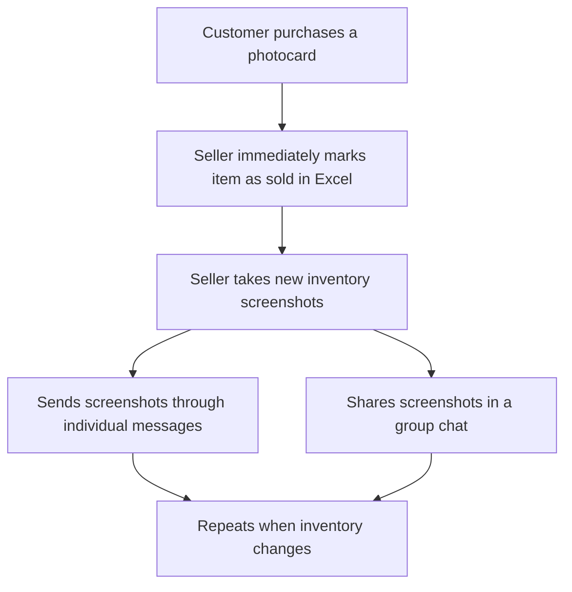
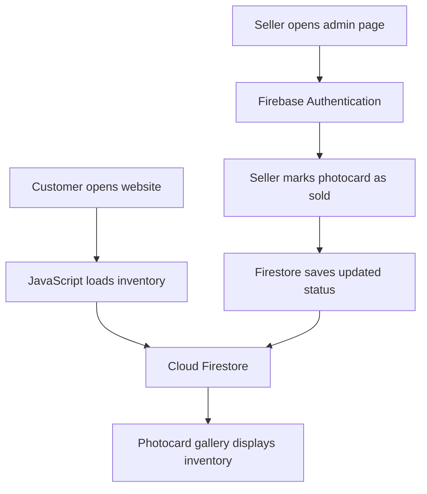

# Photocard Inventory Website

A web-based inventory catalog that helps an independent photocard seller share updated prices and availability with customers without repeatedly taking screenshots.

**Partner:** Independent XG Photocard Seller  
**Partner's role:** Owner  
**Team:** Isimar Lara  
**Course:** CMP 464/343 Product 2  
**Last updated:** November 24, 2026  
**Live demo:** In development — see Demo section  
**Target completion:** November 30, 2026

---

## 1. About the Partner

My partner is an independent seller who sells XG photocards to collectors and fans. He uses Instagram and other cites to communicate with potential buyers through individual messages and a group chat. His customers can browse available photocards, ask about prices, and contact him when they are interested in purchasing an item.

Currently, he organizes his photocard inventory using Microsoft Excel. His spreadsheet contains pictures of photocards, identification numbers, prices, and availability information. Whenever a photocard is sold, he immediately updates the spreadsheet to keep his records accurate.

One challenge he faces is having to repeatedly take new screenshots of his updated inventory and share them with customers. He wants a more convenient way to keep customers informed about available photocards while reducing the amount of repetitive work involved.

## 2. Discovery Log

### Conversation #1 · [Actual date] · [In person / phone] · With business owner

**Their goals:** Make it easier to share updated photocard inventory with customers and reduce the time spent taking and sending screenshots.

**How the work happens today:** The seller uses Microsoft Excel to organize his photocards. When a customer purchases an item, he immediately marks it as sold in Excel so he does not forget. He takes updated screenshots of his inventory and shares them through Instagram, both individually and in a group chat.

**Pain points (how often · what it costs):** The seller estimates that he updates and shares inventory screenshots approximately twice a week. Constantly updating Excel, taking new screenshots, and sharing them becomes tedious. Although the exact time spent has not been measured, the process creates additional repetitive work.

**Tools they use now:** Microsoft Excel and Instagram.

**What they've tried / wish existed:** He currently uses screenshots to communicate inventory availability. He would prefer a simpler way for customers to see updated inventory without needing new screenshots every time something changes.

**Best quote:** [Insert his exact words. Paraphrase from discovery: He finds it annoying to repeatedly update Excel and take new screenshots.]

## 3. Workflow Map (Today)

The seller's current inventory-sharing process works as follows:

**Workflow problems:**

- 🔁 **Repetitive:** Inventory changes require manual updates and new screenshots.
- 🔴 **Slow:** Capturing and sharing updated screenshots takes additional time.
- ❌ **Error-prone:** Previously shared screenshots may show outdated availability.
- 🕳️ **Falls through the cracks:** Customers viewing older screenshots may not have the latest inventory information.

## 4. Problem Statement

When a photocard is sold, the seller struggles to keep the inventory information he shares with customers up to date without repeatedly taking and sending new screenshots. He immediately updates his Excel spreadsheet after each sale to avoid forgetting and to keep his records accurate. However, he also shares inventory screenshots through individual Instagram messages and a group chat, making the process repetitive and time-consuming. He estimates that he needs to update and share screenshots approximately twice per week. This happens because the information customers receive is shared as static screenshots that do not change when the original spreadsheet is updated.

**They'll know this is solved when:** Customers can access current photocard prices and availability without the seller having to repeatedly capture and distribute updated inventory screenshots.

## 5. Existing vs Desired Solutions

| Area | Today (existing) | Desired | Gap |
|---|---|---|---|
| Inventory organization | Microsoft Excel | An organized inventory customers can browse | Customers cannot directly browse his private spreadsheet |
| Availability updates | Manually marks items as sold in Excel | Update availability in one place | Existing screenshots do not update automatically |
| Customer access | Sends screenshots through Instagram | Share one link containing current inventory | Repeated screenshots are necessary |
| Searching inventory | Customers look through shared images | Search by photocard ID | Finding specific items can be inconvenient |
| Inventory sharing | Individual messages and group chat | Same inventory link for all customers | Different customers may have older screenshots |

**Solution type:** Custom web application using existing backend services.

**Why this fits the partner:** The seller already has an inventory organization system, but sharing that information with customers requires repetitive work. A simple website would allow customers to view inventory through one link while giving the seller an easier way to update availability.

## 6. Features & Benefits

| Feature (what it does) | Benefit for the partner | MVP or Later? |
|---|---|---|
| Photocard gallery showing pictures, IDs, prices, and availability | Customers can browse inventory through one link | MVP |
| Search and availability filtering | Customers can find specific photocards more easily | MVP |
| Private admin login with availability updates | Seller can mark items as sold without taking new screenshots | MVP |
| Add new photocards through admin interface | Seller can expand inventory without editing code | Later |
| Edit prices through admin interface | Easier price management | Later |
| Individual images for every photocard | More detailed browsing experience | Later |
| Automatic Excel synchronization | Avoids maintaining inventory in two places | Later |

**Not doing:** Online payments, checkout, shipping-label creation, customer accounts, or storage of customer addresses.

The initial version will focus on a small sample of inventory rather than importing the entire Excel workbook.

## 7. Tech Stack & Architecture

### Surface

**Surface:** Web application.

**Why:** Customers will primarily access the inventory through a link shared on Instagram. The seller will access a private admin interface to manage availability. The website should work on phones and computers.

### Stack

| Piece | Choice | Why |
|---|---|---|
| Front end / interface | HTML, CSS, JavaScript | Build the website layout and interactive features |
| Back end / automation logic | Firebase services and JavaScript | Manage inventory updates without building a separate server |
| Data | Cloud Firestore | Store photocard IDs, prices, availability, and image references |
| Outside services / APIs | Firebase SDK and Authentication | Connect the website to the database and manage admin access |
| Hosting / where it runs | GitHub Pages | Make the customer website publicly accessible |

### Architecture

The website will retrieve photocard information from Firestore. When the seller logs in and changes an item's availability, the update will be saved in the database and reflected on the customer-facing website. Database security rules will restrict inventory modifications to the authorized seller.

## 8. Solution Brief (For the Partner)

**The problem we heard:** Keeping your photocard inventory updated for customers requires too much repetitive work. Whenever inventory changes, you have to update Excel, take new screenshots, and share them again.

**What we're building:** A website where customers can browse your photocards, view prices, and check availability. You'll also have a private login where you can update which photocards are sold.

**How it will help:** Instead of constantly taking and sharing new screenshots, you can send customers the same website link. When you update a photocard's availability, customers will see the current information. The goal is to eliminate the need for routine inventory screenshots, which you currently update approximately twice per week.

**What you'll need to do:** Log into the website whenever a photocard is sold and change its availability. You can continue using Excel for customer names, shipping addresses, and order records.

**What it won't do (yet):** The website will not process payments, automatically import Excel information, or handle shipping. Customers will continue contacting you through Instagram to make purchases.

## 9. Demo

**Status:** Planned — development has not started.

The planned demonstration will show a customer opening the website, browsing photocard inventory, and searching for a specific photocard. It will then show the seller logging into the admin page, marking a photocard as sold, and verifying that the customer-facing inventory displays the updated availability.

**Screenshot:** [Add screenshots or a short demonstration video after development.]

**Live link:** [Add deployed website URL.]

## 10. Partner Feedback

**Date and format:** [To be completed after the partner tests the working website.]

**Quote 1:** [Actual partner feedback]

**Quote 2:** [Actual partner feedback]

**What worked:** [Complete after testing.]

**What didn't / was confusing:** [Complete after testing.]

**What they'd want next:** [Complete after testing.]

## 11. Team (Pairs Only)

Not applicable — individual project.

## 12. What We Learned

During the initial planning process, I learned that choosing the right technology depends on the needs of the business and the amount of time available to complete the project.

Initially, I considered connecting the seller's existing Excel workbook directly to the website. I explored Microsoft Graph API and Google Sheets as possible ways to access inventory information. However, the Excel workbook contains many images and visual labels, which made transferring its contents more complicated than expected. When testing Google Sheets, some of the labels did not display correctly, and the original workbook exceeded the file-size limit.

I used AI assistance to compare different approaches and better understand APIs, backend services, and database options. One limitation of the initial AI guidance was that spreadsheet integration appeared simpler than it actually was for this particular workbook. After recognizing those limitations, I decided to use Firebase to store inventory information separately.

This planning process helped me understand the importance of keeping the first version of a project manageable. Instead of attempting to recreate the entire Excel workbook, I will begin with a smaller inventory sample and prioritize the features that address the seller's main problem.

**What I would do differently:** Before selecting a technology, I would examine how the partner's existing data is organized and test whether it can be transferred successfully. I would also prioritize essential features earlier to avoid spending too much time exploring complicated integrations.