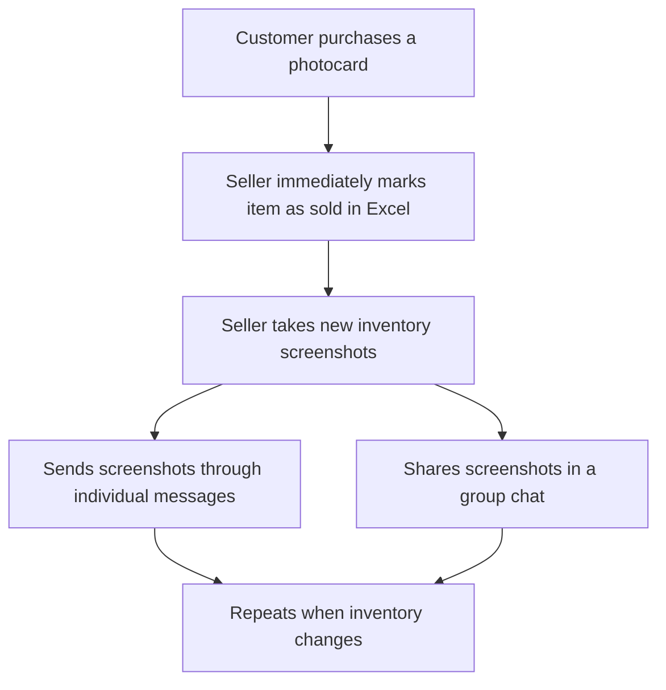
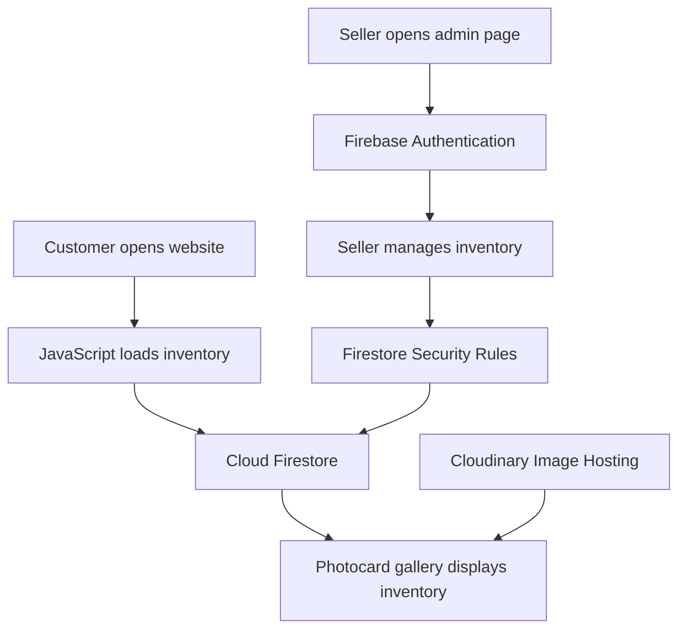
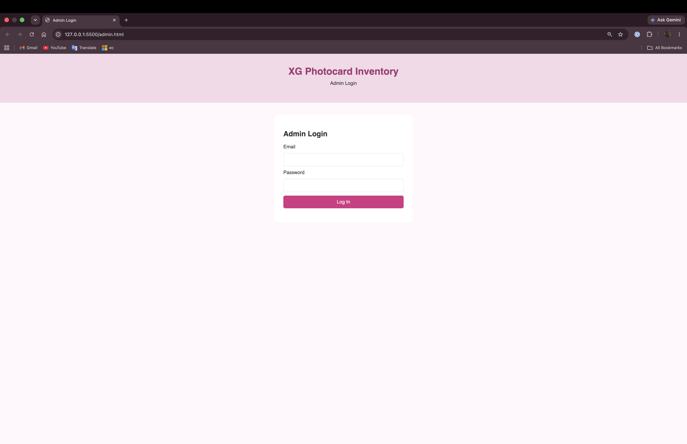
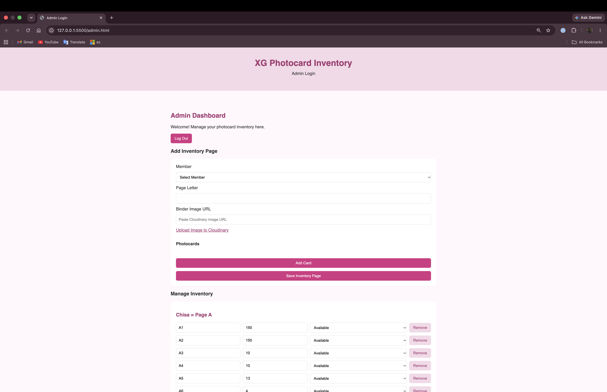
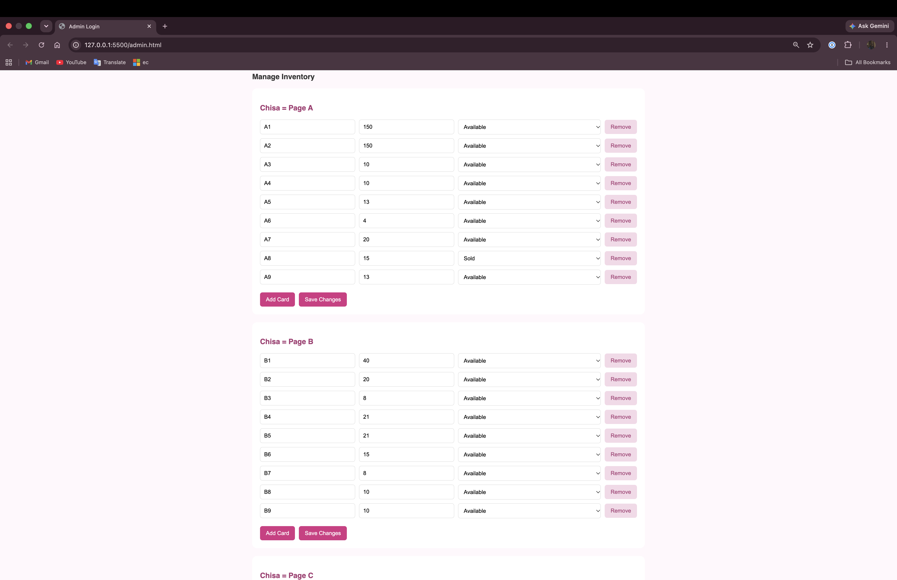

# Photocard Inventory Website

A web-based inventory catalog that helps an independent photocard seller share updated prices and availability with customers without repeatedly taking screenshots.

**Partner:** Independent XG Photocard Seller  
**Partner's role:** Owner  
**Team:** Isimar Lara  
**Course:** CMP 464/343 Product 2  
**Last updated:** November 25, 2026  
**Live demo:** [Photocard Inventory Website](https://isimar914.github.io/photocard-catalog/)
**Target completion:** November 30, 2026

---

## 1. About the Partner

My partner is an independent seller who sells XG photocards to collectors and fans. He uses Instagram and other sites to communicate with potential buyers through individual messages and a group chat. His customers can browse available photocards, ask about prices, and contact him when they are interested in purchasing an item.

Currently, he organizes his photocard inventory using Microsoft Excel. His spreadsheet contains pictures of photocards, identification numbers, prices, and availability information. Whenever a photocard is sold, he immediately updates the spreadsheet to keep his records accurate.

One challenge he faces is having to repeatedly take new screenshots of his updated inventory and share them with customers. He wants a more convenient way to keep customers informed about available photocards while reducing the amount of repetitive work involved.

## 2. Discovery Log

### Conversation #1 · 11/13/2026 · In person · With business owner

**Their goals:** Make it easier to share updated photocard inventory with customers and reduce the time spent taking and sending screenshots.

**How the work happens today:** The seller uses Microsoft Excel to organize his photocards. When a customer purchases an item, he immediately marks it as sold in Excel so he does not forget. He takes updated screenshots of his inventory and shares them through Instagram, both individually and in a group chat.

**Pain points (how often · what it costs):** The seller estimates that he updates and shares inventory screenshots approximately twice a week. Constantly updating Excel, taking new screenshots, and sharing them becomes tedious. Although the exact time spent has not been measured, the process creates additional repetitive work.

**Tools they use now:** Microsoft Excel, Instagram, Discord, and Reddit.

**What they've tried / wish existed:** He currently uses screenshots to communicate inventory availability. He would prefer a simpler way for customers to see updated inventory without needing new screenshots every time something changes.

**Best quote (paraphrased):** He expressed frustration with having to constantly update his Excel spreadsheet, take new screenshots, and send them to customers whenever his inventory changes. He would prefer to have one link that customers can access at any time without having to repeatedly send updated screenshots.

## 3. Workflow Map (Today)

The seller's current inventory-sharing process works as follows:

**Workflow problems:**

- 🔁 **Repetitive:** Inventory changes require manual updates and new screenshots.
- 🔴 **Slow:** Capturing and sharing updated screenshots takes additional time.
- ❌ **Error-prone:** Previously shared screenshots may show outdated availability.
- 🕳️ **Falls through the cracks:** Customers viewing older screenshots may not have the latest inventory information.

## 4. Problem Statement

When a photocard is sold, the seller struggles to keep the inventory information he shares with customers up to date without repeatedly taking and sending new screenshots. He immediately updates his Excel spreadsheet after each sale to avoid forgetting and to keep his records accurate. However, he also shares inventory screenshots through individual Instagram messages and a group chat, making the process repetitive and time-consuming. He estimates that he needs to update and share screenshots approximately twice per week. This happens because the information customers receive is shared as static screenshots that do not change when the original spreadsheet is updated.

**They'll know this is solved when:** Customers can access current photocard prices and availability without the seller having to repeatedly capture and distribute updated inventory screenshots.

## 5. Existing vs Desired Solutions

| Area | Today (existing) | Desired | Gap |
|---|---|---|---|
| Inventory organization | Microsoft Excel | An organized online inventory customers can browse | Customers cannot directly browse his private spreadsheet |
| Availability updates | Manually marks items as sold in Excel | Update availability through an admin dashboard | Existing screenshots do not update automatically |
| Customer access | Sends screenshots through Instagram | Share one website link containing current inventory | Repeated screenshots are necessary |
| Browsing inventory | Customers look through shared images | Filter photocards by XG member | Finding photocards for a specific member can be inconvenient |
| Inventory sharing | Individual messages and group chat | Same inventory link for all customers | Different customers may have outdated screenshots |
| Inventory management | Manually edits the Excel spreadsheet | Add, remove, and edit photocards through an admin dashboard | Inventory management and customer access are separate |

**Solution type:** Custom web application using existing backend services.

**Why this fits the partner:** The seller already has an inventory organization system, but sharing that information with customers requires repetitive work. The website allows customers to view updated inventory through one link while giving the seller an easier way to manage prices, availability, and photocards through an admin dashboard without having to modify any code or repeatedly send screenshots.

## 6. Features & Benefits

## 6. Features & Benefits

| Feature (what it does) | Benefit for the partner | MVP or Later? |
|---|---|---|
| Photocard gallery showing pictures, IDs, prices, and availability | Customers can browse inventory through one link | MVP - Completed |
| Member filtering tabs | Customers can browse photocards by XG member | MVP - Completed |
| Private admin login | Prevents unauthorized users from managing inventory | MVP - Completed |
| Edit card IDs, prices, and availability | Seller can easily update existing inventory | MVP - Completed |
| Add and remove photocards through the admin dashboard | Seller can manage inventory without editing code | MVP - Completed |
| Add new inventory pages | Seller can expand the inventory | MVP - Completed |
| Cloudinary image hosting | Seller can add inventory images without accessing GitHub | MVP - Completed |
| Real-time inventory updates | Customers automatically see updated inventory information | MVP - Completed |
| Mobile responsiveness | Customers can browse inventory on phones and computers | MVP - Completed |
| Search by photocard ID | Customers can find specific photocards more easily | Later |
| Availability filtering | Customers can filter available and sold photocards | Later |
| Direct image uploads through the admin dashboard | Seller can upload images without manually copying URLs from Cloudinary | Later |
| Individual images for every photocard | More detailed browsing experience | Later |
| Automatic Excel synchronization | Avoids maintaining inventory in two places | Later |

**Not doing:** Online payments, checkout, shipping-label creation, customer accounts, or storage of customer addresses.

The completed version uses a sample of the seller's inventory rather than importing the entire Excel workbook.

## 7. Tech Stack & Architecture

### Surface

**Surface:** Web application.

**Why:** Customers will primarily access the inventory through a link shared on a platform. The seller will access a private admin dashboard to manage inventory, update prices and availability and add new photocards. The website works on phones and computers.

### Stack

| Piece | Choice | Why |
|---|---|---|
| Front end / interface | HTML, CSS, JavaScript | Build the website layout and interactive features |
| Back end / automation logic | Firebase services and JavaScript | Manage inventory updates without building a separate server |
| Data | Cloud Firestore | Store photocard IDs, prices, availability, and image URLs |
| Authentication | Firebase Authentication | Restrict inventory management to the authorized admin |
| Image hosting | Cloudinary | Store and display photocard inventory images |
| Outside services / APIs | Firebase SDK and Cloudinary | Connect the website to external services |
| Hosting / where it runs | GitHub Pages | Make the website publicly accessible |

### Architecture

The website retrieves photocard information from Firestore and displays inventory images hosted through Cloudinary. When the seller logs in and makes changes through the admin dashboard, the changes are saved in the database and automatically reflected on the customer-facing website. Database security rules restrict inventory modifications to the authorized admin.

## 8. Solution Brief (For the Partner)

**The problem we heard:** Keeping your photocard inventory updated for customers requires too much repetitive work. Whenever inventory changes, you have to update Excel, take new screenshots, and share them again.

**What we built:** A website where customers can browse your photocards, view prices, check availability, and filter inventory by XG member. You also have a private admin dashboard where you can edit prices, change availability, add or remove photocards, and create new inventory pages.

**How it will help:** Instead of constantly taking and sharing new screenshots, you can send customers the same website link. Whenever you update your inventory through the admin dashboard, customers can see the updated information.

**What you'll need to do:** Log into the admin dashboard whenever you need to update your inventory. When adding new inventory pages, upload the images to Cloudinary and paste the image URL into the dashboard. You can continue using Excel for customer names, shipping addresses, and order records.

**What it won't do (yet):** The website does not process payments, automatically synchronize with Excel, support direct image uploads, or handle shipping. Customers will continue contacting you through Instagram to make purchases.

## 9. Demo

**Status:** Completed, deployed, and tested on November 25,2026

The demonstration includes a short video of the customer-facing website and admin dashboard, showing how customers can browse photocard images, view prices and availability, and switch between different XG members using the member tabs.

Screenshots of the admin login page and admin dashboard are also included to show how the seller can access and manage their inventory. The admin dashboard allows the seller to edit card IDs, prices, and availability, add or remove photocards, and create new inventory pages.

### Screenshots

**Admin Login Page**

**Admin Dashboard**

### Demo Videos

- [Customer Website Demonstration](screenshots/Photocard-Catalog.mov)
- [Admin Dashboard Demonstration](screenshots/Admin-Dashboard.mov)

**Live links:**
- [Customer Website](https://isimar914.github.io/photocard-catalog/)
- [Admin Dashboard](https://isimar914.github.io/photocard-catalog/admin.html)

## 10. Partner Feedback

**Date and format:** [To be completed after the partner tests the working website.]

**Quote 1:** [Actual partner feedback]

**Quote 2:** [Actual partner feedback]

**What worked:** [Complete after testing.]

**What didn't / was confusing:** [Complete after testing.]

**What they'd want next:** [Complete after testing.]

## 11. Team (Pairs Only)

Not applicable — individual project.

## 12. What We Learned

During the initial planning process, I learned that choosing the right technology depends on the needs of the business and the amount of time available to complete the project.

Initially, I considered connecting the seller's existing Excel workbook directly to the website. I explored Microsoft Graph API and Google Sheets as possible ways to access inventory information. However, the Excel workbook contains many images and visual labels, which made transferring its contents more complicated than expected. When testing Google Sheets, some of the labels did not display correctly, and the original workbook exceeded the file-size limit.

I used AI assistance to compare different approaches and better understand APIs, backend services, and database options. One limitation of the initial AI guidance was that spreadsheet integration appeared simpler than it actually was for this particular workbook. After recognizing those limitations, I decided to use Firebase to store inventory information separately.

Throughout the development process, I learned how to connect a website to a database using Firebase. I learned how to retrieve, display, and update information using JavaScript instead of manually adding every photocard to the HTML. I also learned how to use Firebase Authentication and database security rules to prevent unauthorized users from modifying inventory.

Another challenge I faced was figuring out how to store the inventory images. I decided to use Cloudinary because it allowed me to store images separately from the website. This also made it possible for the seller to add new inventory pages without accessing GitHub or editing the code.

This project helped me understand the importance of keeping a project manageable and focusing on the partner's main problem. Although I did not import the entire Excel workbook, I successfully created a working website that allows the seller to manage and share inventory with customers.

**What I would do differently:** Before selecting a technology, I would examine how the partner's existing data is organized and test whether it can be transferred successfully. I would also prioritize essential features earlier to avoid spending too much time exploring complicated integrations.